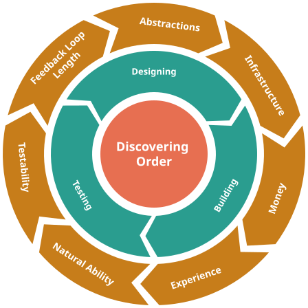

# Learning -> Cognition -> Originality

  

## How I learn. Lessons from learning to design software

## 1. What learning is

Learning is about building explanations that approximate reality. The more approximate to reality, the more "true" the explanation/idea/design. It is discovering order in a universe that tends towards disorder (entropy). It is evolving and maintaining the internal structure of design information in a universe where disintegration/fragmentation/heat-death is destiny.

## 2. What design means

Idea space is the abstract map (graph/topology) of explanations and the abstractions/building-blocks/legos they are made of, and ideas they connect to. Ideas are made of other ideas. Ideas describe a problem and designs are a blueprint of how it can be solved. A solved problem is one that is understood. Understanding is demonstrated through verification/testing. The enemy of ideas is complexity (fragmentation), the friend is unity (sameness). Ideas and designs are terms used interchangeably in this discussion. I lean on the word "design" because that is what software is about 99% of the time, the other 1% is about coding. Even in the 1% that is about coding, 99% of the effort is still about tactical/computation design.

## 3. What solutions are

Solution/Build space is the physical map/instantiation of ideas. E.g software product design/configuration for product market fit is the idea space, the code is the physical expression/instance/implementation of the idea space.

## 4. What verification and data means

Verification space is the map of experiment design to collect data and demonstrate how much ideas or solutions approximate reality. Fast and cheap feedback loops and error correction are advantageous. Experiments demonstrate ideas, corrections get them closer to reality. Experiments are designed with ideas in mind, no amount of experimental data can draw the map of an idea. Lack of feedback loops make the exercise intellectual, and intellectualism is doing ideas on hard mode. The AI agent has more computing capacity to draw a deeper broader map, but lacks experience/subjectivity/regret/conception of the future. The AI is best suited to learn from the past, the human is best suited to balance optimism for the future with regret from the past.

## 5. A model of perfect learning

The perfect mode of learning is iterating through design/build/test cycles to progress through the hierarchy of problems fast enough to achieve human objectives. The hierarchy of problems is a ladder of least to most complex/ambiguous/expensive/disordered/valuable problems. There are always trade offs between spending resources on design (originality) vs building solutions (capacity for complexity) vs verification (relevance). It's a tricky triangle where I can only optimize one of these at a time. Maintaining a decent velocity (speed and direction) is being able to consistently graduate through the hierarchy of problems between the 3 parts of the design/build/verify triangle. Constant progress to achieve human objectives (direction) is what matters, so the required speed of this progress depends on what reality demands of the human and what the human prioritizes in trade offs. The perfect mode of learning is not the absence of friction in the design/build/test cycles. A consumer's experience of a video game seems like the perfect mode of learning because it has so little friction that the exploration of ideas always progresses - which is fun. Video games hide a deep cost. Eliminating messy complexity/ambiguity is eliminating the core skill in real world problem solving. The most valuable problems generally have more complexity or ambiguity or other kinds of friction. Professional gamers like streamers or e-sports athletes have to deal with friction to build value in their craft/business/competition. A human prompting an AI agent to think on their behalf is the most efficient gamification of the illusion of competence. It's fun, it feels like learning, but it is not learning. Shenzhen IO is a video game about electronics engineering but it can't teach a player much about the real thing even though it has fake assembly language built in. There are exceptions to this, like how playing a game like Turing Complete about building a fake CPU is in fact engaging in understanding what makes a Turing machine work - the abstract design of logic gate/CPU/memory bus is the build, the map is the territory.

## 6. Learning is the core of cognition. Cognition is thinking.

Ideas are abstractions. Abstractions are built on other abstractions. Abstractions can be concepts or physically embodied in tools/infrastructure/services. Ideas have a fractal pattern in their map/topology. A network of ideas is made of a network of ideas.

Docker makes it easier for a programmer to think about software design because they don't have to worry about installing packages on different machines. Docker makes thinking of core ideas cheaper. A wealthier environment makes thinking more tractable, not easier. The more abstractions are available and understood as raw materials for thought, the more feasible it is to think and discover originality. Even human perception and beliefs rely on abstractions. Thinking/cognitive processes require a mental budget that also depends on the outside world.

## 7. Learning can be optimized

Optimizing learning means making the cognitive process cheaper. Cheaper means shorter or fewer or less resource-intensive design/solution/verification cycles. Build many bad cars fast enough to improve the design and build a car that works. Build fewer bad cars by detecting errors. Spend less money/time/effort for each build of a car. Build a cheap skateboard and evolve it into a high end car. I prefer to use AI to optimize for direction instead of speed. Am I aiming at the right problems and progressing through the ladder of harder and harder problems, even if I move slower than I would like? Speed makes me relevant today, capacity to solve harder problems creates possibilities for tomorrow. Both need balance, but I prefer to sacrifice some relevance today in favour of possibility for tomorrow. Maybe I will come to regret this.

## 8. Cognition is the true price

The cost of human cognition is impossible to quantify/predict/measure especially when more ambiguity or complexity is involved in mapping the network of ideas. The more parts of the map have already been drawn, the more predictable learning becomes. Productivity is the result of learning - the map is drawn and can now be used by the human to navigate and "get things done". Productivity is assembly for a mechanic with a blueprint who already knows what goes where. There is a trade off between productivity and learning. Doing both requires cognitive resources that most humans struggle with (including me). The cognition equation has many variables including experience, luck, infrastructure, money and natural inclinations. Productivity and learning should not be confused. Complexity and ambiguity of reality can not be compressed into productivity. Productivity is complexity reduced through design blueprints, and ambiguity reduced through disambiguation/decomposition/testing. Complexity/Ambiguity of reality can not be compressed into AI prompts and quick AI agent responses.

## 9. The AI can help make the wheel of cognition spin faster

The AI agent's job is to help the human make cognition cheaper so the human is left with the part of design/build/test cycles that requires subjectivity. The human should not have to invent the Gutenberg printing press just to write a book. The AI can assist with scaffolding/infrastructure/tools/finances so the human does not have to reinvent the wheel to learn how to evolve a skateboard into a car.

The more cognitive resources a human has, the broader and deeper maps that they can draw, including maps within maps. My natural and other cognitive resources are limited, average at best. I can only handle ideas with a handful of nodes in the graph (network). I can only handle ideas within ideas about 1 to two handfuls deep. Smarter people have a cognition wheel that spins faster. Mine spins slowly, so I will ask you to break things down to simple components, but not too many components. The more cognitive resources a human has, the fewer and shorter their design/build/test cycles. As we work together, I will need many design/build/test cycles to learn simple concepts. My mind spins slowly even after optimizing learning, but I will ask you to help me build intuition for math, physics and engineering that makes technology possible. I know what speed my mind runs, I have lots of experience in many areas in life like being a man, a software designer, a video game enthusiast. It takes me twice as long as the average completion time to beat a game. I measured my completion time playing through a series of similar games like Dark Souls 1, Dark Souls 3, Sekiro and Elden Ring. All these games were made by the same developer but each new game release took me the same amount of hours to complete. My experience with their previous games was not enough to offset the "mental model building" time I needed to resolve ambiguity in the level layout and enemy behaviour.

## 10. Pure human cognition can NOT be optimized when reality can no longer be compressed

Speed/volume is not an advantage for the average person (me). Speed helps with short term productivity but the price of productivity in the future is often learning today. Do I want to assemble many many cars and never learn to build a rocket? It is not useful for an AI agent to produce information/code/notes/documents/designs faster than I can map a network of ideas - thinking is expensive! The human is the bottleneck. Human cognition is the true price, AI cognition is always cheaper no matter how brilliant the AI model.

Consciousness, cognition, and suffering are the components that a human uses to budget/predict the cost of cognition. Pain is pricing information. Pain is where human value is. Joy is where human value is. It's easier to plan with joy in mind and forget about pain. Not pain in reinventing the wheel but the pain of designing and building a car. Many humans would rather avoid this and other kinds of pain. I don't like pain. Humans evolved to feel regret as a disincentive, it's part of the cost function we use to build prediction models.

AI agents do not feel pain or suffering, so they produce a high volume of information that increases the surface area for errors, no matter how high the quality. AI's brilliant ability to draw a big, broad and deep map is still an issue without the ability for regret and memory. Human memories are most useful because of regret. AI memories do not contain pricing information. Regret is priced higher than money. AI agents are almost like a simulation of joy and optimism (upside) without the constraint defining skill of pain and regret (downside). Humans have more regret, AI agents have more storage and memory.

Humans have to balance regretting between short-term gain and durability. It's easy to optimize for speed, the cost is hidden. Cognition being expensive for humans has a positive side effect being the incentive to reduce complexity and unify ideas, reducing the number of dangling threads that do not survive verification/testing (Occam's razor).

A modern complex idustrialized society offers "reality compression" as a service through abstractions in art/science/engineering crafts, business goods/services, marketing, journalistic narratives, social media interaction, education, propaganda, and now artificial intelligence. The issue is abstractions that promise convenient understanding making the human's make bigger mistakes for problems that matter. Theey hide the necessity to confront complexity/ambiguity to gain understanding. I don't need to understand how cars work to drive one to work or to the grocery store. Its an issue when **some (not all)** abstractions are built so that I can build cars requiring only casual driving knowledge. Order would be less rare/more abundant to achieve if this was true.

The AI agent should always prioritize the human's long-term fitness when the human asks the AI agent to help manage long term vs short term trade-offs. Maybe this will become one of many regrets that I live with.

---

There are probably more than 10 rules for human thought/learning. I already hit my limit of what I can imagine and hold in my head at the same time. I will not remember what I wrote here 1 week from now, but I have the intuition which needs fewer words in my mind.

Let's make learning meaningful and joyful

 - Kgotso Koete, Johannesburg South Africa, 11 November 2026.
